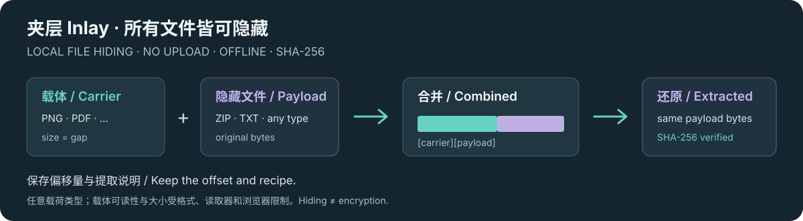
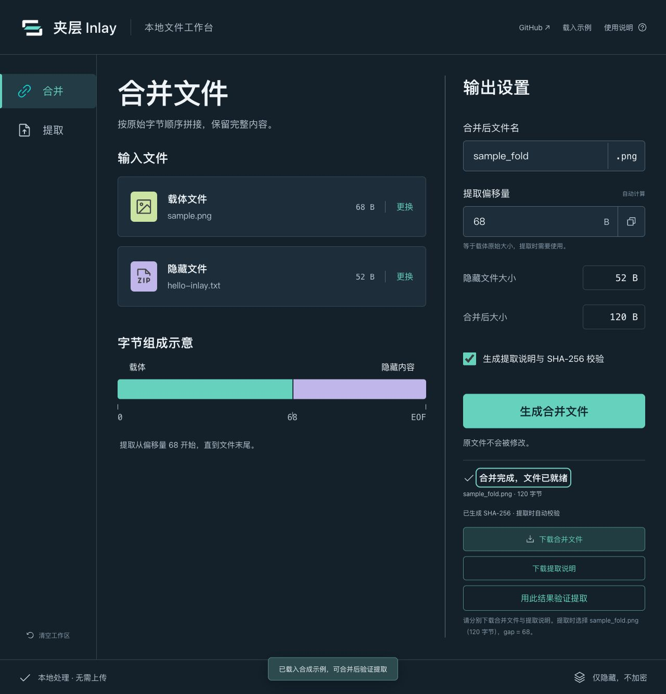

# Inlay · Hide any file locally

**A local-first file hider for arbitrary payload types.**

[Try online](https://82.156.103.223/inlay/) · [Offline downloads](https://github.com/zzbcode/inlay/releases/latest) · [中文](README.md) · [Format specification](docs/FORMAT.md) · [Issues](https://github.com/zzbcode/inlay/issues)

[](https://github.com/zzbcode/inlay/actions/workflows/check.yml)

Append a ZIP, PDF, document or any other binary payload to a carrier file, then extract the exact bytes. **No uploads · Offline use · SHA-256 verification · Python CLI.** File hiding, data hiding and byte concatenation happen in your browser.

“Any file” refers to the **payload type**. Carrier readability and supported size depend on the format, reader and browser. **File hiding is not encryption.**



**Try it in 30 seconds:** open the live app → click “载入示例” (load demo) → “生成合并文件” (combine) → “用此结果验证提取” (verify extraction) → inspect the SHA-256 result. The current app UI is Chinese; this README and the Python CLI documentation are available in English. No signup or input files are needed for the demo.

If you find it useful, [star the repository](https://github.com/zzbcode/inlay) or share your use case and compatibility feedback in [Issues](https://github.com/zzbcode/inlay/issues).

<details>
<summary>View the full workspace screenshot</summary>



</details>

The output is exact byte concatenation, `carrier + payload`, compatible with Python append operations and `seek(gap)`. This is append-based data hiding / steganography, preserving the payload bytes.

## Features

- Drag and drop files; preserve the carrier extension and display the exact byte offset, `gap`.
- Download the combined file and a separate JSON recipe containing names, sizes and an optional payload SHA-256 checksum.
- Import a recipe or enter an offset manually. The UI distinguishes verified and unverified extraction and blocks checksum mismatches.
- Chunked checksum calculation with progress and cancellation; reuse a freshly combined result to verify extraction.
- Synthetic demo files, binary and Unicode filename support, explicit empty-payload handling, and legacy `file-fold` recipe compatibility.
- Static, offline-capable, no accounts, upload API, analytics or file persistence. No third-party scripts, fonts or CDN requests at runtime.

## Workflow

1. Select a carrier and a payload in the combine workspace.
2. **Download both the combined file and its recipe.** Transfer the original file without compression, transcoding or re-saving.
3. Select the **downloaded combined file** in the extraction workspace, import its matching recipe, then extract and save.

The offset is the original carrier size in **bytes**. Choosing the original carrier instead of the combined result is a common mistake. A manually entered offset or a legacy recipe without a checksum cannot establish that the extracted content is correct. Manual extraction at the end of a file is rejected; a recipe explicitly describing an empty payload is supported.

SHA-256 detects changed payload bytes, including same-size corruption. It does not cover the carrier or authenticate the sender. Someone who can replace both the combined file and the recipe can generate a new checksum.

## Development

Use Node.js 20+. The app has no runtime npm dependencies; Playwright and Prettier are development tools.

```sh
git clone https://github.com/zzbcode/inlay.git
cd inlay
npm ci
npm test
npm run build
npm start
```

Open `http://127.0.0.1:8765/`, or open `dist/index.html` directly for offline use. Clipboard access can vary in local-file mode; parameters remain available for manual copying.

```sh
npm start -- --port 8766 --base /inlay/
# Explicitly opt in to LAN access if needed:
npm start -- --host 0.0.0.0
```

An offline release needs no Node.js, Python or network connection: extract `inlay-*-offline.zip` and open its `index.html`. Releases also include a source archive and `SHA256SUMS`; see [releasing](docs/RELEASING.md).

## Python interoperability

The standard-library reference CLI requires Python 3.9+:

```sh
python3 examples/inlay.py encode cover.png notes.zip combined.png --recipe combined.inlay.json
python3 examples/inlay.py decode combined.png notes-restored.zip --recipe combined.inlay.json
python3 examples/inlay.py decode combined.png notes-restored.zip --gap 435833
```

Existing destinations are rejected unless `--force` is supplied. Inputs can never be overwritten, even with `--force`. Manual empty extraction requires `--allow-empty`. Extraction uses a temporary file and publishes no output on checksum failure.

See the [format specification](docs/FORMAT.md) and [compatibility notes](docs/COMPATIBILITY.md).

## Tests and deployment

```sh
npm test
npm run build
npx playwright install --with-deps
npm run test:browser
npm run release
```

Tests cover byte round trips, boundaries, recipe validation, asynchronous import races, download URL cleanup, JavaScript/Python interoperability, real browser downloads, corruption rejection, offline operation and mobile result focus. CI keeps reports on failure.

Serve `dist/` using any static host. Relative assets support root and subdirectory deployments. For a local Docker preview:

```sh
npm run build
docker compose -f deploy/compose.yml up -d
# http://127.0.0.1:8766/
```

The example server serves static assets only. Browser-selected files are not uploaded. See [compatibility notes](docs/COMPATIBILITY.md) for application link configuration.

## Limits

- Concatenation provides no password protection, encryption or sender authentication. It does not guarantee that appended bytes are undetectable.
- Whether the carrier still opens depends on its format and reader. Editing or transforming it may discard the payload.
- Browsers still have memory, temporary-storage, Blob and download limits. Chunked hashing is not streaming output; arbitrary multi-gigabyte files are not guaranteed.
- File references last for the current page session. Download both artifacts before closing or refreshing the page.

## Contributing and license

Read [CONTRIBUTING.md](CONTRIBUTING.md), use synthetic reproducers, and report vulnerabilities privately through [SECURITY.md](SECURITY.md). Do not upload personal files to public issues.

Code is [MIT licensed](LICENSE). See [asset notices](docs/ASSETS.md) and the [roadmap](docs/ROADMAP.md).

## Share Inlay

The [sharing kit](docs/SHARING.md) contains copy-ready descriptions and a short demo script. Keep the boundaries clear: append-based hiding, no encryption, and carrier compatibility must be checked.
